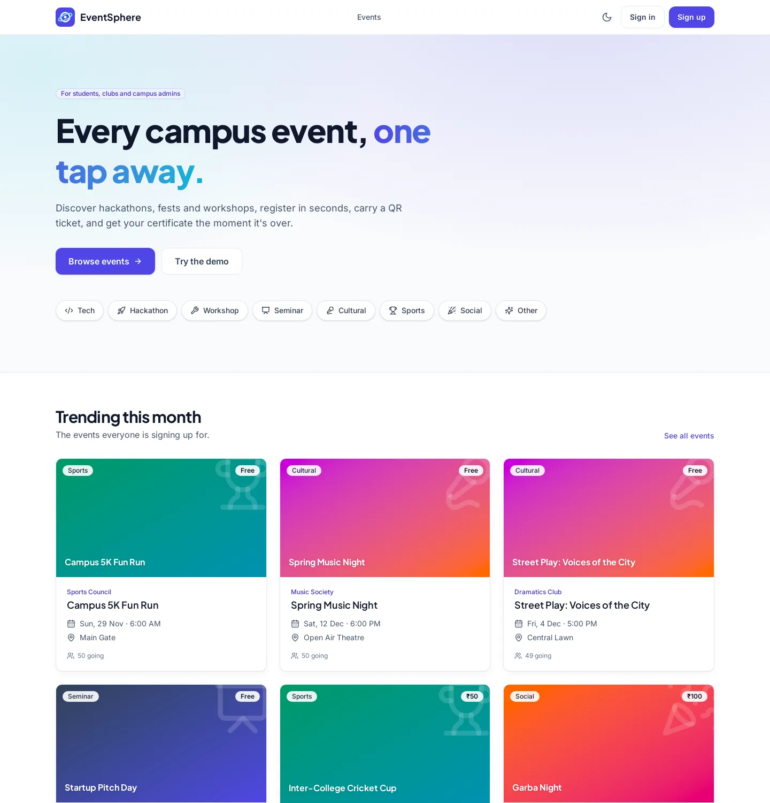
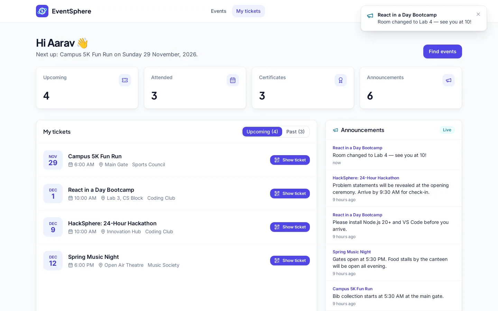
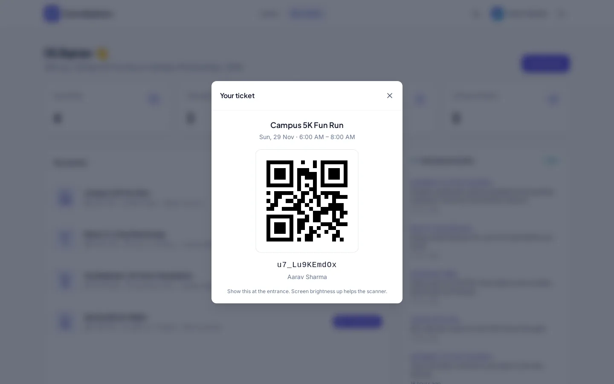
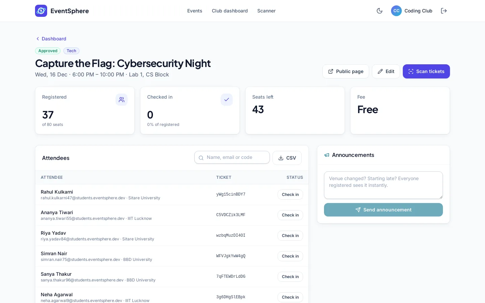
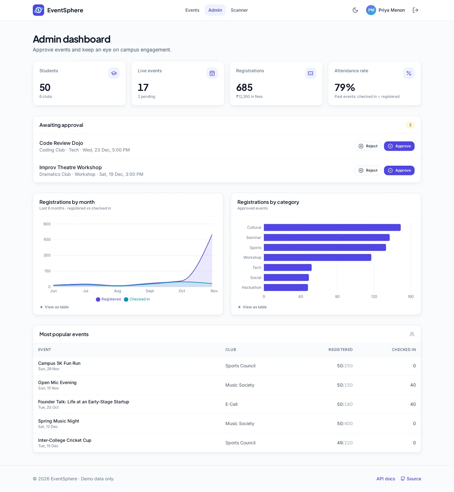
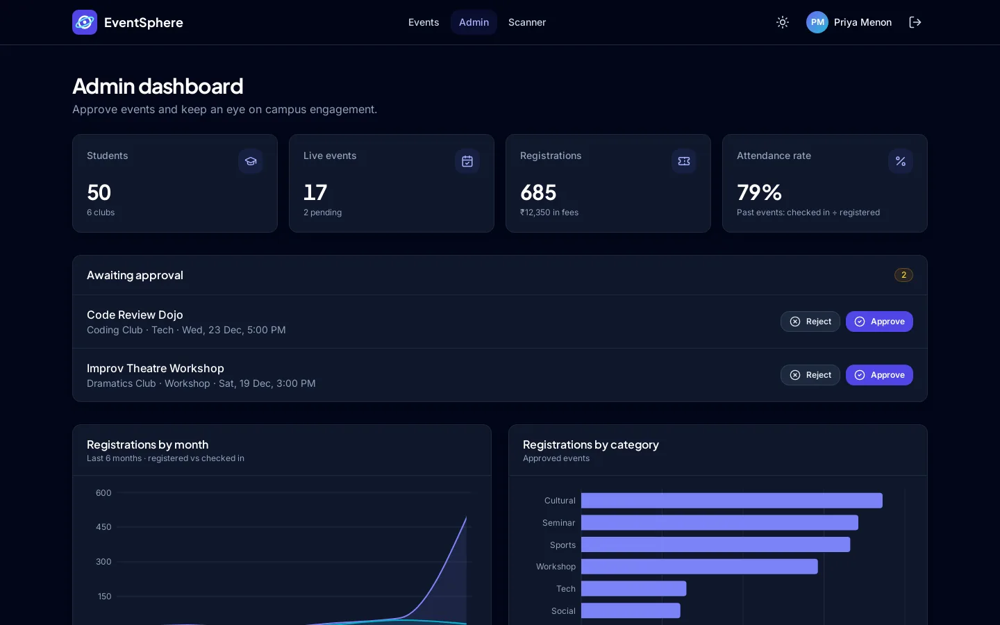
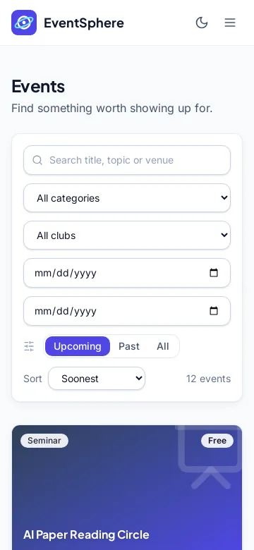
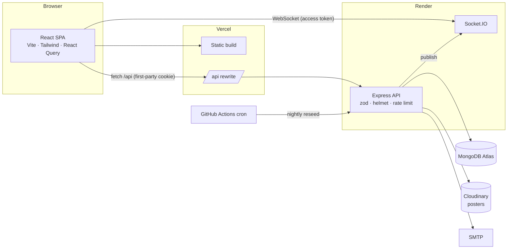
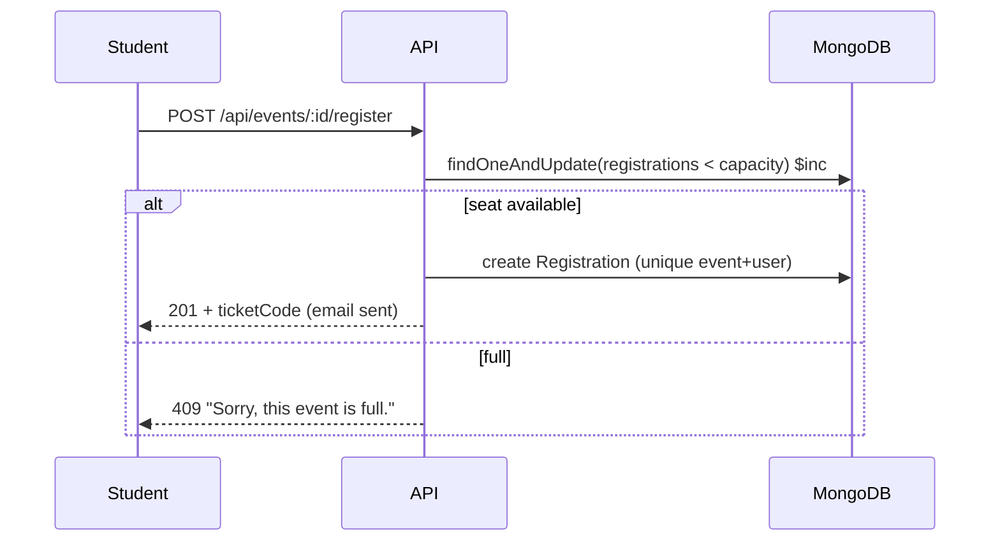

# EventSphere

[](https://github.com/arjunkadampatil/eventsphere/actions/workflows/ci.yml)


[](LICENSE)

**A university event platform: discover events, register in one tap, carry a QR ticket, get live announcements and download a certificate the moment it's over.**

**Live demo:** _deploying. Link coming soon._ · **API docs:** `/api/docs`

| Role | Email | Password |
|---|---|---|
| Student | `student@eventsphere.dev` | `Demo@1234` |
| Club | `club@eventsphere.dev` | `Demo@1234` |
| Admin | `admin@eventsphere.dev` | `Demo@1234` |

The login page has one-click buttons for each role. All data is fictional and resets nightly.



| Live announcement + tickets | QR ticket | Club: attendees, CSV, announcements |
|---|---|---|
|  |  |  |

| Admin analytics | Dark mode | Phone (360px) |
|---|---|---|
|  |  |  |

More: [events catalogue](docs/screenshots/events.webp) · [event page](docs/screenshots/event-detail.webp) · [door scanner](docs/screenshots/scanner.webp)

---

## Features

**Students**
- Browse approved events with search, category/club/date filters, upcoming/past toggle, sorting and pagination. Filters live in the URL, so any search is shareable.
- Register in one tap and cancel before the event starts. Seats are claimed with an atomic MongoDB update, so a 100-seat event never sells 101 seats, even under concurrent requests.
- Each registration has a **QR ticket** and a confirmation email.
- Club announcements arrive **live** over Socket.IO as toasts and in a feed.
- Download a **PDF certificate** (with a verification code) once you've been checked in and the event has ended.

**Clubs**
- Create and edit events, with poster upload to **Cloudinary** (image type and 5 MB size are checked server-side). Events without a poster get a category-designed cover.
- Attendee list with search, manual check-in and a **CSV export**. The export is protected against spreadsheet formula injection and opens in Excel with the correct encoding.
- **QR scanner page** (html5-qrcode) that works on a phone camera, with a typed-code fallback and duplicate-scan protection.
- **Send announcements** to everyone registered, delivered instantly.

**Admins**
- Approval queue: approve, or reject with a reason the club sees. A club that edits a rejected event resubmits it for review.
- Analytics: KPIs, registrations vs check-ins by month, and registrations by category (Recharts), plus the most popular events.

**Platform**
- JWT access tokens (15 min) and **rotating refresh tokens** in an httpOnly cookie. Replaying an old refresh token revokes the whole session family.
- Role middleware (`student` / `club` / `admin`) and ownership checks on every write.
- zod validation with field-level error messages, one centralized error handler, helmet, rate limiting (stricter on auth routes), and a CORS allow-list.
- Optional Google sign-in. No token ever appears in a URL or inline script.
- OpenAPI 3 docs (Swagger UI) at `/api/docs`.

## Architecture



The client calls `/api` on its own domain, and Vercel rewrites those calls to the API. That keeps the refresh cookie first-party, so it survives Safari's cross-site cookie blocking. WebSockets connect straight to the API host with the access token.



## Tech stack

| Layer | Tools |
|---|---|
| Client | React 18, Vite, Tailwind CSS v4, React Router, TanStack Query, Recharts, html5-qrcode, qrcode.react, socket.io-client |
| Server | Node 22, Express 5, Mongoose 8, zod, Socket.IO, Passport (Google), Multer + Cloudinary, Nodemailer, pdf-lib, swagger-ui-express |
| Security | helmet, express-rate-limit, bcrypt, JWT with refresh rotation, CORS allow-list |
| Testing | Jest + Supertest + mongodb-memory-server (server), Vitest + Testing Library (client) |
| CI/CD | GitHub Actions (lint, test, build; nightly demo refresh), Render, Vercel, MongoDB Atlas |

## Project structure

```
eventsphere/
├── server/                 Express API
│   ├── src/
│   │   ├── routes/         auth, events, me, clubs, admin
│   │   ├── models/         User, Event, Registration, Announcement, RefreshToken
│   │   ├── middleware/     auth/roles, validation, errors, rate limits, uploads
│   │   ├── services/       tokens, storage, mailer, certificate, realtime
│   │   ├── docs/openapi.js
│   │   └── seed/           demo data
│   └── tests/
└── client/                 React SPA
    └── src/
        ├── pages/          Landing, Events, EventDetail, Auth, student/, club/, admin/, Scanner
        ├── components/     UI kit, EventCard, Poster, Layout
        ├── context/        auth, toasts
        └── lib/            API client (auto-refresh), socket, formatting
```

## Run locally

Requirements: Node 20+, and MongoDB running locally or an Atlas connection string.

```bash
git clone https://github.com/arjunkadampatil/eventsphere.git
cd eventsphere
npm install
cp server/.env.example server/.env    # set MONGODB_URI if not local
npm run seed                          # 6 clubs, 20 events, 50 students
npm run dev                           # API on :4000, client on :5173
```

Open http://localhost:5173 and use a demo login. The Vite dev server proxies `/api` and `/socket.io` to the API.

## Environment variables

**Server** (`server/.env`; every variable is documented in [`server/.env.example`](server/.env.example)):

| Variable | Required | Purpose |
|---|---|---|
| `MONGODB_URI` | yes | MongoDB / Atlas connection string |
| `JWT_ACCESS_SECRET`, `JWT_REFRESH_SECRET` | in production | Long random strings; the server refuses to start with the dev defaults |
| `CLIENT_URL` | yes | Client origin (CORS, email links, OAuth redirect) |
| `CORS_ORIGINS` | no | Extra allowed origins, comma-separated |
| `CLOUDINARY_URL` | in production | Poster storage. Without it, posters go to local disk (dev only) |
| `GOOGLE_CLIENT_ID`, `GOOGLE_CLIENT_SECRET`, `GOOGLE_CALLBACK_URL` | no | Enables "Continue with Google" |
| `SMTP_HOST`, `SMTP_PORT`, `SMTP_USER`, `SMTP_PASS`, `MAIL_FROM` | no | Emails print to the console without SMTP |
| `DEMO_MODE`, `RESEED_SECRET` | no | Enable the protected nightly reseed endpoint |

**Client** (`client/.env`): `VITE_SOCKET_URL` (API host for WebSockets in production). `VITE_API_URL` is only needed if you don't use the `/api` rewrite.

## API

Interactive docs: **`/api/docs`** (Swagger UI) · raw spec: `/api/openapi.json`.

| Method | Endpoint | Who |
|---|---|---|
| POST | `/api/auth/register` · `/login` · `/refresh` · `/logout` | public |
| GET | `/api/auth/me` · `/providers` · `/google` | – |
| POST | `/api/auth/forgot-password` · `/reset-password` | public |
| GET | `/api/events?q&category&club&from&to&when&sort&page&limit` | public |
| GET | `/api/events/:id` | public (approved) / owner / admin |
| POST · PATCH · DELETE | `/api/events` · `/api/events/:id` | club (own) / admin |
| GET | `/api/events/manage?status=` | club (own) / admin (all) |
| PATCH | `/api/events/:id/status` | admin |
| POST · DELETE | `/api/events/:id/register` | student |
| GET | `/api/events/:id/attendees` · `/attendees.csv` | owner club / admin |
| POST | `/api/events/:id/check-in` | owner club / admin |
| GET · POST | `/api/events/:id/announcements` | public / owner club |
| GET | `/api/me/registrations` · `/announcements` · `/registrations/:id/certificate` | student |
| PATCH | `/api/me` | signed in |
| GET | `/api/clubs` | public |
| GET | `/api/admin/analytics` | admin |

**Socket.IO:** connect with `auth: { token }` to receive `announcement` events for every event you're registered for. Emit `event:follow` with an event id to follow a public event page.

## Tests

```bash
npm test                              # server (Jest) + client (Vitest)
npm run test:coverage -w server
```

**74 tests: 62 server (92% line coverage) and 12 client.** CI runs everything on every push; the server suite uses a real MongoDB through mongodb-memory-server. The tests cover:

- **Auth:** registration and role-escalation attempts, identical errors for wrong passwords and unknown emails, refresh-token rotation, **stolen-token replay revoking the whole session family**, logout, password reset (single-use, no account enumeration) and rate limiting.
- **Events:** visibility of pending and rejected events, filters, search with regex-escaping, pagination, validation of time and venue rules, poster uploads (valid and malicious files), ownership checks, and the approve/reject flow.
- **Registrations:** **8 concurrent sign-ups for 3 seats produce exactly 3 registrations**, plus duplicate, closed and unapproved events, and cancellation freeing the seat.
- **Attendance:** single-use check-in, wrong-event tickets, cross-club access, CSV escaping (`=HYPERLINK` injection and quotes), and certificate rules (attended and event ended).
- **Real time:** a Socket.IO client receives announcements both as a registered student and as an anonymous follower; invalid tokens are rejected.
- **Analytics, seed integrity** (counters match registrations; capacity is never exceeded) and the secret-protected reseed endpoint.
- **Client:** one-click demo login and redirects, API errors mapped onto form fields, event card states, and the formatting and query helpers.

**Lighthouse** (production build, simulated mobile):

| Page | Performance | Accessibility | Best practices | SEO |
|---|---|---|---|---|
| Landing | 80–96 | 100 | 100 | 100 |
| Events | 92–93 | 100 | 100 | 100 |
| Event detail | 95 | 100 | 100 | 100 |
| Login | 99 | 100 | 100 | 100 |

The landing-page performance range is run-to-run variance in blocking time on the shared CI runner.

## Deploy

1. **MongoDB Atlas:** create a free M0 cluster, allow access from anywhere (`0.0.0.0/0`), and copy the connection string.
2. **Cloudinary:** copy the `CLOUDINARY_URL` from the dashboard.
3. **Render (API):** New → Blueprint → this repo ([`render.yaml`](render.yaml)). Fill in `MONGODB_URI`, `CLOUDINARY_URL`, `CLIENT_URL` (your Vercel URL) and `CORS_ORIGINS`. With `DEMO_MODE=true`, the API seeds an empty database on first start, so no shell access is needed.
4. **Vercel (client):** import the repo with **root directory `client`** and set `VITE_SOCKET_URL=https://<render-app>.onrender.com`. If your Render URL differs, update it in [`client/vercel.json`](client/vercel.json).
5. **Nightly reset (optional):** add the repo secrets `API_URL` and `RESEED_SECRET` so [`reseed-demo.yml`](.github/workflows/reseed-demo.yml) runs every night.

## Roadmap

- Real payments (Razorpay) for paid events, replacing the free-only flow
- Waitlists that auto-promote when someone cancels
- Calendar (.ics) export and reminder emails 24 hours before
- Event feedback and ratings after attendance
- PWA offline mode for the door scanner

## Team & credits

EventSphere started as a team project in 2025.

- **Arjun Kadam** ([@arjunkadampatil](https://github.com/arjunkadampatil))
- **Rohitprasad95albert** ([@Rohitprasad95albert](https://github.com/Rohitprasad95albert))

Both contributors' original commits are preserved in this repository's history.

### What's new in v2 (rebuilt by Arjun Kadam)

| Area | v1 | v2 |
|---|---|---|
| Structure | `backend/` + static HTML pages | npm-workspaces monorepo: `server/` + `client/` |
| Frontend | 14 hand-written HTML pages, inline scripts | React 18 SPA with routing, data caching, lazy-loaded dashboards, light/dark mode, 360px-responsive |
| Data model | Attendees embedded in events; date and time stored separately | `Registration` collection with a unique (event, user) index; a single `startsAt`/`endsAt` timestamp |
| Privacy | `GET /api/events` was public and returned **every attendee's name and email**, plus pending events | Public API shows approved events only; attendee lists need the hosting club or an admin; meeting links go only to registered students |
| Attendance | Anyone could mark anyone present by submitting their email | Random, unguessable QR ticket codes, checked in by the hosting club and single-use |
| Auth | 8-hour JWT in `localStorage`; Google callback wrote the token into an inline `<script>` (XSS risk); login revealed which emails exist | 15-minute access tokens in memory + rotating httpOnly refresh cookie with reuse detection; OAuth never exposes tokens; uniform login errors; rate limiting |
| Validation and errors | Ad-hoc checks; status update accepted any string | zod schemas on every route; one error shape `{ error: { message, details } }` |
| Capacity | Read-then-write: could oversell under load | Atomic `$inc` with a capacity condition (tested with concurrent requests) |
| Uploads | Local disk (lost on every Render deploy) | Cloudinary, with type and size limits |
| Real time | none | Socket.IO announcements with toasts and a live feed |
| Certificates | Required each club to upload a PDF template; text placement guessed | Generated, branded PDF with a verification code |
| Docs and tests | none | OpenAPI/Swagger, 74 tests, CI, nightly demo refresh |
| Repo hygiene | Replit state, uploaded files, a 20 MB zip in history | Purged from history; `.gitignore` and documented `.env.example` files |

## License

[MIT](LICENSE)
